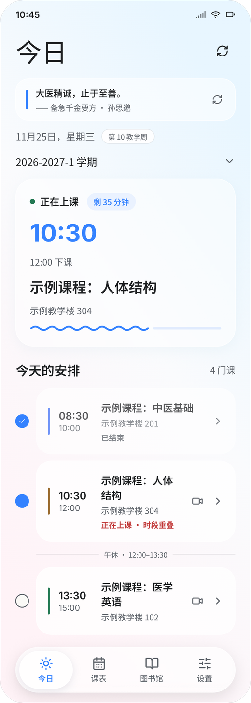
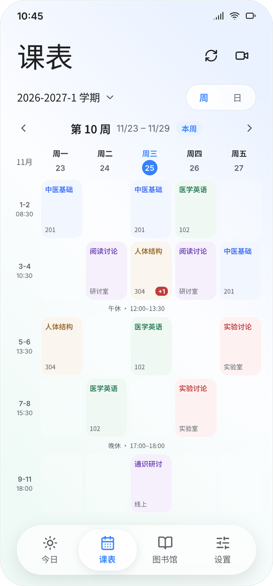
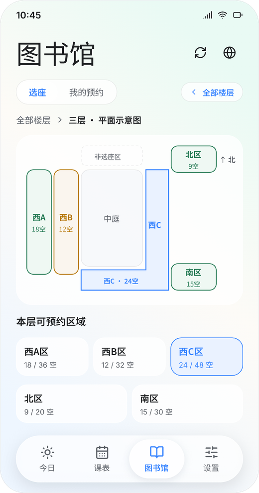
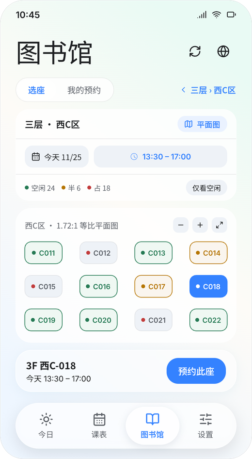
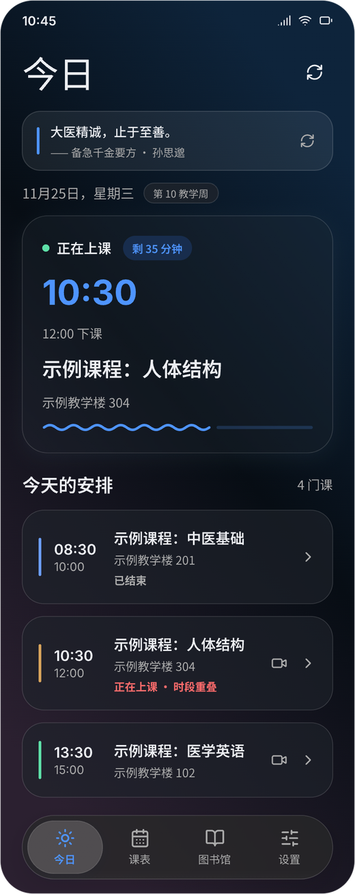
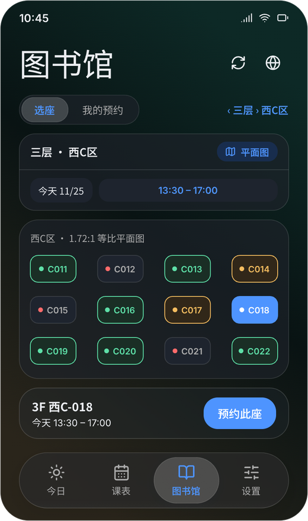
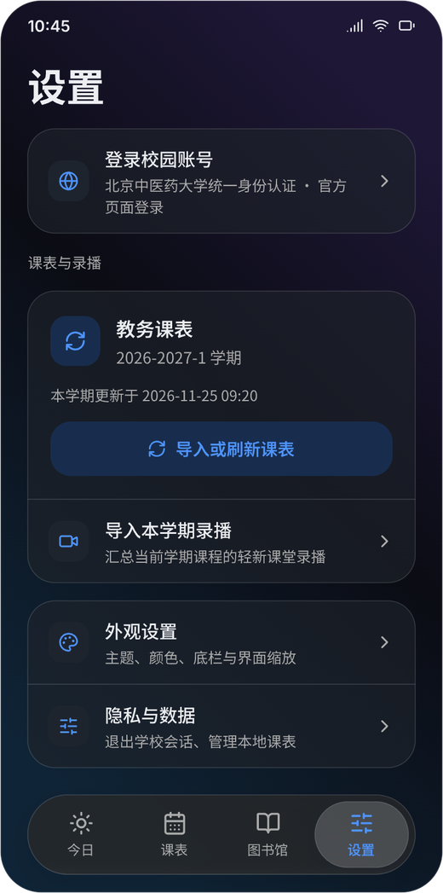
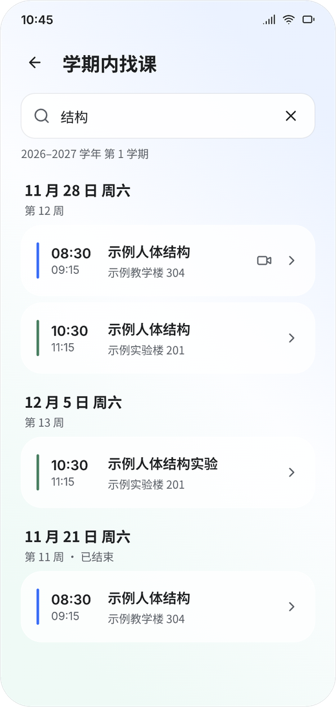
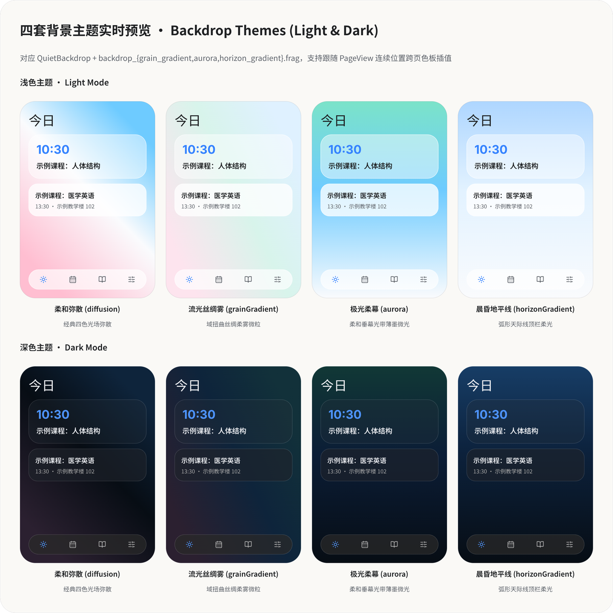
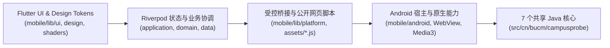

<div align="center">


# 校园课表 · BUCM

**面向北京中医药大学的非官方 Flutter Android 校园应用**

官方页面本人认证 · 离线课表与找课 · 轻新课堂多画面录播 · 图书馆三级空间选座

<p>
  <a href="https://github.com/zhihaorao8-web/bucm-campus-prototype/releases/tag/v0.42"></a>
  
  
  
</p>

<p>
  <a href="#界面预览">界面预览</a> ·
  <a href="#功能列表">功能列表</a> ·
  <a href="#功能实现与架构">功能实现与架构</a> ·
  <a href="#下载安装">下载安装</a> ·
  <a href="#安全与验证范围">安全与验证范围</a> ·
  <a href="#开发与构建">开发与构建</a>
</p>

</div>

---

本应用在学校官方页面由本人完成认证，于本机导入并离线查看课表、按课名搜索本学期排课、整理轻新课堂录播目录并进行原生多画面播放，同时提供图书馆原生空间选座、查单与取消预约。主线工程位于 `mobile/`，默认分支为 `main`，更新记录见 [CHANGELOG](CHANGELOG.md)。

## 界面预览

> 以下界面均由项目 Pen 设计稿（`design/bucm-campus.pen`）结合**合成示例数据**导出，不含任何真实课表、个人账号或真机敏感截图。

### 浅色核心页面

<table>
  <tr>
    <td align="center" valign="top" width="25%">
      <br />
      <b>今日焦点</b><br />
      <sub>本地语录 · 授课分段进度 · 时间轴</sub>
    </td>
    <td align="center" valign="top" width="25%">
      <br />
      <b>课表周视图</b><br />
      <sub>相邻错色 · 全宽层叠冲突抽屉</sub>
    </td>
    <td align="center" valign="top" width="25%">
      <br />
      <b>图书馆 L2 示意</b><br />
      <sub>楼层方位图 · 区域热区导览</sub>
    </td>
    <td align="center" valign="top" width="25%">
      <br />
      <b>图书馆 L3 选座</b><br />
      <sub>等比平面选座 · 悬浮预约胶囊</sub>
    </td>
  </tr>
</table>

### 深色模式与学期内找课

<table>
  <tr>
    <td align="center" valign="top" width="25%">
      <br />
      <b>今日 · 深色</b><br />
      <sub>暗色柔光场 · 授课进度卡片</sub>
    </td>
    <td align="center" valign="top" width="25%">
      <br />
      <b>图书馆选座 · 深色</b><br />
      <sub>状态色阶 · 底部快捷预约</sub>
    </td>
    <td align="center" valign="top" width="25%">
      <br />
      <b>设置首页 · 深色</b><br />
      <sub>统一登录 · 课表录播 · 隐私隔离</sub>
    </td>
    <td align="center" valign="top" width="25%">
      <br />
      <b>学期内找课</b><br />
      <sub>本机离线搜索 · 按日期聚合</sub>
    </td>
  </tr>
</table>

<details>
<summary><b>展开查看：四套着色器背景主题预览（浅色 / 深色 · 开发分支预览）</b></summary>
<br />
<p align="center">
  <br />
  <sub>开发分支 <code>codex/backdrop-themes</code> 中的单 Pass FragmentProgram 背景主题（柔和弥散 / 流光丝绸雾 / 极光柔幕 / 晨昏地平线），支持四页子样式与跨页连续渐变过渡，尚未随 <code>0.42</code> 合入 <code>main</code>。</sub>
</p>
</details>

---

## 功能列表

### 1. 课表导入、离线阅读与学期内找课
- **高可靠官方导入**：优先读取教务官方二进制 XLS（DOM 备用），整批校验与完全重复去重（兼容全/半角括号），失败自动保留既有课表，提供备份恢复与导入变更摘要。
- **学期内离线找课**：从「课表」右上角按部分课名离线搜索当前所选学期，保留全部同名课程排课并按日期列出，复用日视图卡片、冲突标记与课程详情入口。
- **多视图课表体验**：
  - **今日**：教学周、此刻/下一节焦点大卡、授课分段进度条、连接时间轴与本地 24 条语录（可选开启默认关闭的「在线一言」）。
  - **周视图 / 日视图**：默认工作日五列同屏（外观可选周末七列）、相邻错色、全列宽层叠冲突 + 底部详情抽屉、周次横滑、单层磨砂星期栏与多学期切换。

### 2. 轻新课堂录播与多画面播放
- **目录直取与离线翻页**：支持统一批量导入或单课刷新，按同学期精确匹配全部同名课程来源（兼容全/半角括号），完整分页成功后原子保存；离线可查看目录，点播时重新核验当次学校权限。
- **课程课堂二级页**：实时模糊「录播 / 直播」滑动胶囊（直播明确标注未开放）、合并维护卡与按日期/来源组织的结构化回放时间线。
- **内置原生多画面播放器**：
  - 默认 PPT 主画面 + 教师小窗，按实际来源自由切换学生画面；支持主小画面交换、小窗单指拖动与双指缩放、独立关闭/恢复、倍速、前后 10 秒跳转、本机续播与点击播放 `280ms` 圆形扩张入场。
  - 横竖屏均支持主画面左右滑动与进度条拖动实时预览时间（松手单次跳转）；沉浸式横屏透明控件闲置自动隐藏，右上角单按钮展开不超过半屏的画面切换侧抽屉。

### 3. 图书馆座位预约
- **统一底栏直达**：四项悬浮玻璃底栏（`今日 · 课表 · 图书馆 · 设置`）惰性加载，合成示例模式下自动隔离不发起学校请求。
- **三级渐进空间选座**：
  - **L1 楼层目录** → **L2 平面示意图**（专绘 2F 独立构图与 3–5F 含中庭、北向标识及连续 L 形西 C 区）→ **L3 区域具体座位**（`1.72:1` 等比平面选座图 / 紧凑 4 列可搜网格双视图）。
- **克制防误操作流程**：内置 `08:30–22:00` 时段轴抽屉、余位复核与防连点 `QuietSheet` 二次确认、「我的预约」焦点票卡及原生查单与取消。

### 4. 统一校园账号认证
- **独立无状态登录入口**：直连复用官方 CAS 三标签会话（账号密码 / 手机短信 / 企业微信扫码），校外 WebVPN 保留独立扫码通道（图书馆仅直连）。
- **自动回跳恢复**：课表导入、录播点播与图书馆查单触发认证时保留原业务上下文，本人完成后自动回跳目标任务并重新校验权限；写操作认证中断后仅查单，不自动重发。

### 5. 柔光视觉系统、品牌图标与无障碍
- **材质与动效**：MIUIX 界面体系、柔光亚克力浅/深色弥散光场、悬浮玻璃胶囊底栏与液态玻璃微折射（含路由/Hero 转场滤镜暂停保护），支持 Monet 动态配色、系统字号/缩放、高对比度与减少动画完整降级。
- **原创艺术标题与品牌素材**：「今日」「课表」「图书馆」展开大标题采用自研 **B1 Macintosh Skeletal Filled** 矢量轮廓与 `1350ms` 逐笔描边入场动效（上滑折叠与「设置」保持系统字体）；全新宣纸米暖底双杏仁嫩芽应用启动图标（`28B-1`），全应用统一 49 个离线 IconMCP SVG 功能图标，许可随包提供。

> [!NOTE]
> **当前未开放范围**：实际直播、学校观看记录上报（**本机续播不等于学校观看记录**）、图书馆其他业务、课程提醒、社区、视频下载、后台播放及 iOS / Windows 交付均未开放。

---

## 功能实现与架构

应用采用 **Flutter + Riverpod 主工程 + 共享 Java 解析核心 + 受控公开网页脚本 + Android 原生媒体播放组** 的分层混合架构：



| 核心模块 | 简要实现机制 |
|---|---|
| **课表解析与离线找课** | 复用根目录 `src/` 下 7 个共享 Java 核心（基于 Apache POI HSSF 解析官方二进制 XLS、处理北京时间作息分段与周次），通过 Android 方法通道返回结构化结果；DOM 备用由 `assets/coverage-check.js` 与 `assets/extract.js` 同次校验提取，原子持久化并保留有效备份；`searchCourseOccurrences` 复用教学周与授课分段在本地完成当前学期课名检索。 |
| **录播直取与多画面播放** | 自动按服务可达性选择校园直连或官方 WebVPN（保留手动切换，不读取 Wi-Fi 名称）；在已认证官方会话内直取完整分页并原子归档。点播时按原学校课程 ID + 录播 ID 核验当次权限与媒体边界，移交 Android 原生 Media3 `ClassroomPlayerGroup` 多路同步解码与单音频焦点管理。 |
| **图书馆三级空间选座** | L1/L2 仅同源只读拉取 `/ic-web/seatMenu` 构建楼层与区域模型，进入 L3 后按需加载座位并依据归一化坐标与 `1.72:1` 校方画布比例等比布局（缺坐标自动回落可搜网格）；预约/取消由学校平台校验资格与余位，仅在用户确认后单次提交。 |
| **液态玻璃与无障碍降级** | 基于 Impeller `FragmentProgram` 实现局部液态玻璃微折射，统一由 `AppVisualPolicy` 管理高对比度、减少动画与关闭模糊降级，并通过 `BackdropSuspensionScope` 在路由转场、Hero 飞行与局部渐变期间暂停 `BackdropFilter` 与着色器采样。 |

详细分层、公共复用入口与协议边界见 [架构与复用索引](docs/ARCHITECTURE.md)、[课堂协议与恢复](docs/CLASSROOM.md)、[播放器与来源](docs/PLAYER.md) 与 [界面与交互规范](DESIGN.md)。

---

## 下载安装

**当前版本：`0.42` 预发布 · Android 8.0 及以上。** 仓库已公开，可通过 GitHub Releases 直接下载安装包。

| 安装包 | 适用场景 | 下载链接 |
|---|---|---|
| **正常版（release）** | 日常使用，关闭测试诊断与测试入口 | [下载 0.42 正常版 APK](https://github.com/zhihaorao8-web/bucm-campus-prototype/releases/download/v0.42/campus-schedule-0.42-android-release.apk) |
| **测试版（debug）** | 问题排查，内置可复制、可清空的白名单内存诊断 | [下载 0.42 测试版 APK](https://github.com/zhihaorao8-web/bucm-campus-prototype/releases/download/v0.42/campus-schedule-0.42-android-debug.apk) |

[GitHub 发布页与 SHA-256 校验文件](https://github.com/zhihaorao8-web/bucm-campus-prototype/releases/tag/v0.42) · [0.42 详细版本说明](docs/releases/0.42.md) · [完整变更记录](CHANGELOG.md)

> [!TIP]
> 两个包来自同一源码，均启用已确认的录播目录直取路径；包名、版本与本机开发签名一致，可互相覆盖切换并保留本地数据。沿用既有 Flutter 预览版升级无需清数据（与早期 Java 原型包名不同）。当前仍使用开发签名，正式生产签名方案尚未建立。

---

## 安全与验证范围

> [!IMPORTANT]
> **认证与数据保护底线**
> - 认证全程在可见的学校官方页面由本人扫码或输入凭据完成；应用**不额外记录密码、验证码、Cookie 或令牌**，不经开发者服务器代理学校凭据。
> - 始终保持正常 TLS 校验、逐跳域名与媒体路径检查；自动网络路径按服务可达性判断，**不读取 Wi-Fi 名称**或申请位置权限。
> - 本机仅保存必要课表、录播目录及续播元数据，不下载视频或长期缓存媒体 URL；退出学校会话会清理录播上下文与续播进度，同时保留离线课表。
> - 测试诊断仅在 `debug` 包内存中保留阶段、类别、计数和耗时，不含学校地址、课程或认证内容，不自动上传。

### 验证状态概览

| 维度 | 已有验证证据 | 仍待独立验证 |
|---|---|---|
| **课表、导入与找课** | 官方 XLS 与稳定 DOM 各 31 条整学期逐项对照（0 差异）、单周切换保护、WebVPN 扫码回跳自动导入、隔离 R8 XLS 实测、`0.42` 学期内找课断网与发布抽查通过 | 「无课表课程」独立列表待产品确认 |
| **轻新课堂与播放** | 校园直连目录取数、WebVPN 教学平台 CAS 回跳与原课时恢复、原生双流短时播放与本机续播；用户已确认真机听音与完整课时播放通过 | 水印全部组合、门户直连回跳、真实会话失效恢复、7 天自然跨天会话 |
| **图书馆座位预约** | 模拟器真实校园会话下通过原生提交、非空查单、原生取消、三级空间示意图、双视图及退出会话清理 | 物理真机提交、查单与取消 |
| **界面与材质** | 柔光亚克力、液态玻璃阶段 1–3、`0.41.1` 转场黑块修复、B1 艺术标题、`0.42` 新启动图标及精确 CI 双包核验通过 | 物理真机 Vulkan 渲染/性能/功耗、完整 TalkBack、系统预测返回 |

精确源码 SHA、CI 记录、双包摘要与各阶段实测证据见 [STATUS](docs/STATUS.md)、[0.42 发布说明](docs/releases/0.42.md) 与 [当前开发进度](docs/DEVELOPMENT_PLAN.md)。

---

## 开发与构建

Flutter SDK 固定为 `3.47.9`（引擎提交 `c197ca5199e9ee5661e865596c9c07294dfab51c`）。根目录**不是 Gradle 工程**，Android 主工程位于 `mobile/android/`；根目录共享 Java 核心与 `AndroidManifest.xml`（唯一版本来源）仍参与构建，请勿删除。

```powershell
# 1. 校验锁定依赖并同步共享核心与公开资产
python scripts/dependencies.py
python scripts/prepare_flutter.py

# 2. 获取 Flutter 锁定依赖
cd mobile
flutter pub get --enforce-lockfile
cd ..

# 3. 查看受影响的分层检查计划并按模块运行合成检查
python scripts/check.py --changed --base origin/main --dry-run
python scripts/check.py --module classroom --direct-catalog
```

<details>
<summary><b>展开查看：工程结构、发布构建命令、分支说明与完整文档索引</b></summary>

### 工程结构

```text
mobile/                      Flutter Android 主应用、着色器与合成测试
src/cn/bucm/campusprobe/     7 个共享 Java XLS / 作息 / 媒体核心
assets/                      受控公开网页脚本与第三方许可
scripts/                     依赖准备、分层检查与双包构建核验工具
design/                      品牌图标与离线 IconMCP SVG 素材
docs/                        生效需求、进度、架构、验证证据、发布记录与界面预览
AndroidManifest.xml          应用唯一版本来源
```

### 双包构建与 CI 说明

- **发布候选检查**：运行 `python scripts/check.py --all` 并补齐专项验证。
- **双包构建**（在 `mobile/` 目录顺序执行，避免插件注册表冲突）：
  - 正常版：`flutter build apk --release --dart-define=CAMPUS_DIRECT_CATALOG=true --dart-define=CAMPUS_TEST_DIAGNOSTICS=false`
  - 测试版：`flutter build apk --debug --dart-define=CAMPUS_DIRECT_CATALOG=true --dart-define=CAMPUS_TEST_DIAGNOSTICS=true`
- Windows 建议将 pub 缓存与工程置于同盘，本地依赖源与锁文件匹配；GitHub Actions 按分支分层检查，详情见 [Flutter 开发说明](docs/FLUTTER.md) 与 [双包规范](docs/BUILD_VARIANTS.md)。

### 分支说明

- `main`：当前 Flutter Android 稳定主线（最新预发布 `v0.42`，先后合入柔光亚克力重构、图书馆座位预约、统一登录、设置重排、液态玻璃改造、转场黑块修复、学期内离线找课与 `28B-1` 启动图标）。
- [`codex/legacy-java-prototype`](https://github.com/zhihaorao8-web/bucm-campus-prototype/tree/codex/legacy-java-prototype)：早期 Java 测试原型，固定保留原主线 `611ec8e` 与历史发布附件。
- 日常功能迭代在独立工作分支推进，阶段进展见 [当前开发进度](docs/DEVELOPMENT_PLAN.md)。

### 文档索引

| 类别 | 文档入口 |
|---|---|
| **需求与进度** | [生效需求](docs/PROJECT_BRIEF.md) · [当前开发进度](docs/DEVELOPMENT_PLAN.md) · [验证证据](docs/STATUS.md) · [长期项目管理规范](docs/PROJECT_MANAGEMENT.md) |
| **设计与架构** | [界面与交互规范](DESIGN.md) · [架构与复用索引](docs/ARCHITECTURE.md) · [图标系统](docs/ICON_SYSTEM.md) · [课堂协议与恢复](docs/CLASSROOM.md) · [播放器与来源](docs/PLAYER.md) |
| **开发与发布** | [开发入口](docs/DEVELOPMENT.md) · [Flutter 开发说明](docs/FLUTTER.md) · [分层测试](docs/TESTING.md) · [双包规范](docs/BUILD_VARIANTS.md) · [版本规范](docs/VERSIONING.md) · [工程优化台账](docs/MAINTENANCE_PLAN.md) · [第三方许可](docs/THIRD_PARTY.md) |

</details>

---

<sub>本项目为非官方研究与个人使用预发布，不代表学校开放了第三方 API 或正式单点登录接入。仓库与 CI 仅允许合成样本，真实课程、截图、HAR、学校会话、设备标识及签名密钥均不提交。</sub>
